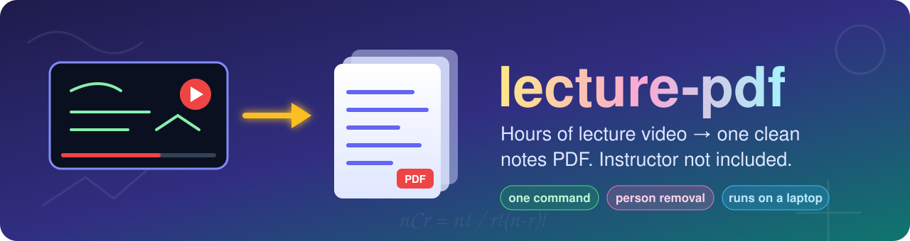
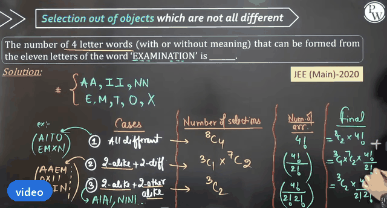
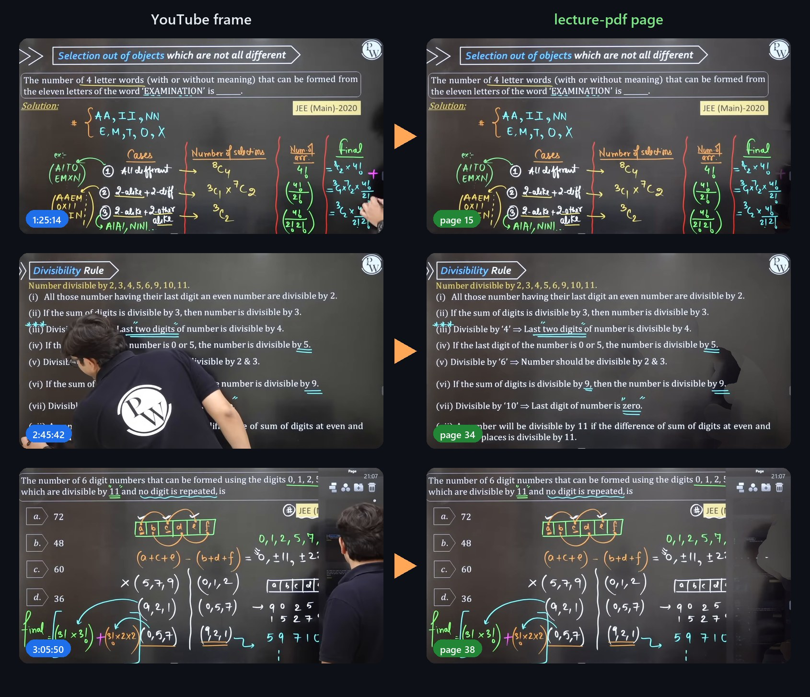
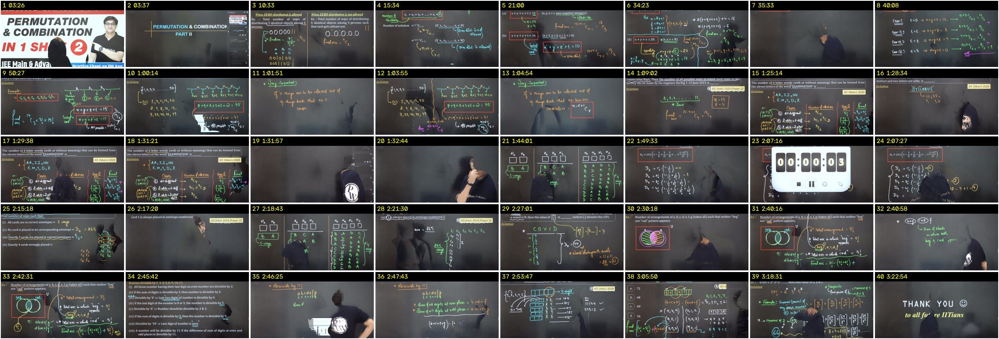
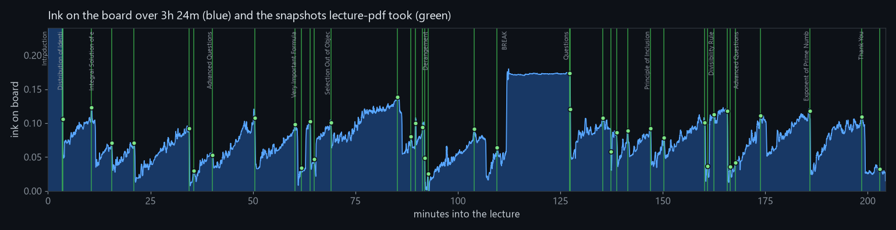
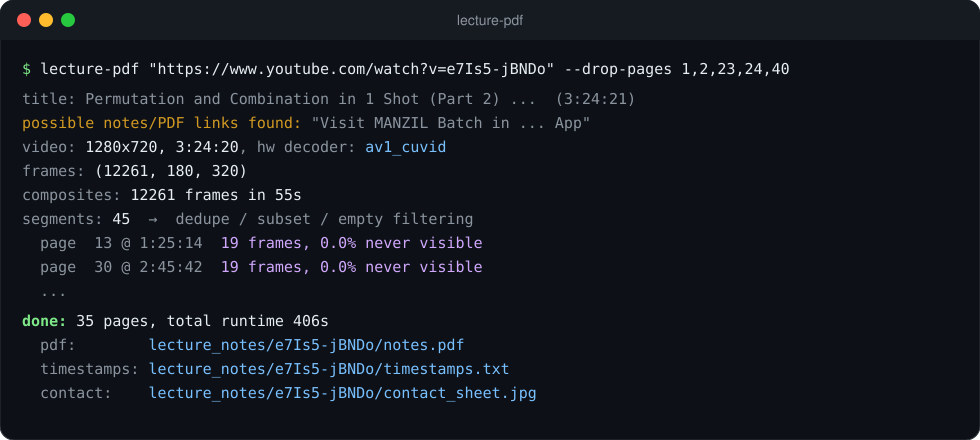
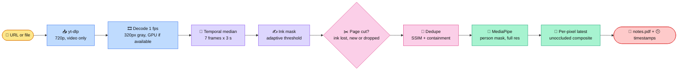

<p align="center">
  
</p>

<p align="center">
  <a href="https://github.com/ishaanseth/lecture-pdf-maker/actions/workflows/ci.yml"></a>
  
  
  
  
  <a href="LICENSE"></a>
  <a href="https://github.com/ishaanseth/lecture-pdf-maker/stargazers"></a>
</p>

<p align="center">
  <b>Paste a YouTube link. Get the board as a PDF.</b><br>
  <code>lecture-pdf</code> watches a blackboard / pen-tablet / slide lecture for you, saves every board <i>right before it gets erased</i>,<br>
  removes the teacher standing in front of it, and gives you a clean notes PDF with a timestamp for every page.
</p>

<p align="center">
  <a href="#-quick-start">Quick start</a> •
  <a href="#-see-it-in-action">Demo</a> •
  <a href="#-how-it-works">How it works</a> •
  <a href="#%EF%B8%8F-tuning">Tuning</a> •
  <a href="#-faq">FAQ</a>
</p>

---

<p align="center">
  
</p>

## ✨ Why

A 3-hour "one-shot" lecture has maybe 35 boards worth keeping. Scrubbing through to screenshot them by hand takes forever, and every screenshot has the instructor covering half the equation.

<table>
<tr>
<td width="33%" valign="top">

### 🎯 Finds every board
It catches erases, slide changes and new slides dropped on top, and ignores the small partial rubs you get mid-derivation. Each page is the fullest version, taken just before the clear.

</td>
<td width="33%" valign="top">

### 🧍‍♂️➡️👻 Removes the teacher
MediaPipe person segmentation and time-aware compositing rebuild the board from the moments he *wasn't* standing in front of it.

</td>
<td width="33%" valign="top">

### ⚡ Light on your laptop
Detection runs on 1 fps, 320 px grayscale frames, and only the final pages are decoded at full resolution. If you have an NVIDIA GPU, decoding happens there.

</td>
</tr>
<tr>
<td valign="top">

### 🕒 Timestamps for every page
`timestamps.txt` maps each page to a point in the video, so you can jump straight back to the explanation.

</td>
<td valign="top">

### 🔎 Checks for official notes first
It scans the description (and comments, if you ask) for notes / DPP / Drive links, so you don't rebuild something that's already published.

</td>
<td valign="top">

### 🔁 Fast reruns
The download and decoded frames are cached, so retuning a threshold takes about a minute instead of a re-download.

</td>
</tr>
</table>

## 📸 See it in action

<p align="center">
  
</p>

<p align="center"><sub>Left: the actual video at that moment. Right: the page in the PDF, with the instructor gone and everything he'd written so far kept.</sub></p>

A full 3h 24m lecture comes out as 35 pages. The contact sheet shows every page at a glance:

<p align="center">
  
</p>

The page cuts line up with the lecture's own chapter markers:

<p align="center">
  
</p>

<p align="center">
  
</p>

## 🚀 Quick start

**Requirements:** Python 3.9+ and [FFmpeg](https://ffmpeg.org/download.html) on your `PATH`.

```bash
pip install git+https://github.com/ishaanseth/lecture-pdf-maker.git
```

```bash
lecture-pdf "https://www.youtube.com/watch?v=VIDEO_ID"
```

That's it. You get:

```text
lecture_notes/VIDEO_ID/
├── notes.pdf            📄 one page per board, in order
├── timestamps.txt       🕒 page → time in the video
├── contact_sheet.jpg    🖼️ all pages at a glance
├── chapters.txt         📑 the video's own chapters (if any)
├── pages/page_001.png … 🔍 full-resolution pages
└── run.json             ⚙️ settings used
```

<details>
<summary><b>Install from source instead</b></summary>

```bash
git clone https://github.com/ishaanseth/lecture-pdf-maker.git
cd lecture-pdf-maker
python -m venv .venv
.venv/bin/pip install -r requirements.txt        # Windows: .venv\Scripts\pip install -r requirements.txt
.venv/bin/python lecture_pdf.py "https://www.youtube.com/watch?v=VIDEO_ID"
```

</details>

It works on any site [yt-dlp](https://github.com/yt-dlp/yt-dlp) supports, and on local files: `lecture-pdf my_lecture.mp4`.

## 🧭 Recommended workflow

```bash
# 1. Is there an official PDF already? Grab 8 sample frames to check the layout.
lecture-pdf URL --comments 200 --stop-if-notes --sample

# 2. Look at samples/montage.jpg (it has a 10% grid) and pick the board area.
lecture-pdf URL --crop 0,0.08,1,0.95            # add --dark-on-light for whiteboards / white slides

# 3. Look at contact_sheet.jpg, then drop the title, break and outro pages.
lecture-pdf URL --crop 0,0.08,1,0.95 --drop-pages 1,2,23
```

Steps 2 and 3 reuse the cached download and frames.

## 🧠 How it works



1. **Ink, not pixels.** Each second becomes a per-pixel *median* of 7 frames taken 3 s apart, so a moving instructor mostly vanishes. An adaptive threshold then turns that into an "ink" mask.
2. **Page cuts that ignore noise.** It compares each composite with one built from completely different frames, one window earlier. A cut happens only if, for 5 s straight, one of these holds:
   - most of the old ink is gone (an erase or slide change);
   - most of the current ink is new (a slide replaced, e.g. a break screen);
   - total ink fell more than 45% below the page's peak.

   Writing only *adds* ink, so it never triggers a cut.
3. **Snapshot at the right moment.** The exact clear time is found in the per-frame series, and the page is built only from frames before it.
4. **Dedupe.** Near-empty pages, near-identical pages (SSIM) and pages fully contained in the next page are dropped.
5. **Teacher removal.** For each page it decodes the ~40 s before the snapshot at full resolution and masks the person with MediaPipe's selfie segmenter. Each pixel is the median of its 3 most recent views with nobody in front, which gives the latest writing with no ghosts.

## 🎛️ Tuning

| Symptom | Fix |
|---|---|
| Toolbar, webcam box or ticker is being read as ink | `--crop x0,y0,x1,y1` (fractions; read them off `samples/montage.jpg`) |
| Static logo or clock inside the board | `--ignore x0,y0,x1,y1` (repeatable) |
| White board / white slides | `--dark-on-light` |
| Two boards merged into one page | lower `--change-ratio` (0.5 → 0.4) or `--drop-ratio` |
| Too many near-duplicates | raise `--change-ratio` / `--gain-ratio`, lower `--ssim-dup` |
| Ghost of the teacher left over | `--mask-dilate 36 --mask-thresh 0.15` |
| Title / break / outro pages | `--drop-pages 1,2,23` |
| Just want the page list | `--detect-only` |

<details>
<summary><b>All options</b></summary>

| Option | Default | What it does |
|---|---|---|
| `--out DIR` | `lecture_notes/<id>` | output folder |
| `--max-height` | `720` | download resolution cap |
| `--comments N` | `0` | also scan the top N comments for notes links |
| `--stop-if-notes` | off | exit with code 3 if a notes/PDF link is found |
| `--sample` | off | download + write `samples/montage.jpg`, then stop |
| `--crop` | `0,0,1,0.955` | board region (fractions) |
| `--ignore` | `0.93,0,1,0.11` | regions ignored for ink (`0,0,0,0` = none) |
| `--dark-on-light` | off | dark ink on a light board |
| `--c` / `--block-small` | `20` / `15` | adaptive-threshold offset / block size |
| `--window` / `--spacing` | `7` / `3` | median window: frame count / seconds apart |
| `--change-ratio` | `0.5` | cut when this share of the old ink vanished |
| `--gain-ratio` | `0.6` | cut when this share of the current ink is new |
| `--drop-ratio` | `0.45` | cut when ink falls this far below the page peak |
| `--sustain` | `5` | seconds a cut condition must hold |
| `--min-page` | `20` | minimum seconds per page |
| `--min-ink` | `0.025` | drop pages with less ink than this |
| `--ssim-dup` / `--contain` | `0.92` / `0.9` | duplicate / subset thresholds |
| `--drop-pages` | – | page numbers to leave out |
| `--no-person-mask` | off | plain median compositing (faster, ghostier) |
| `--mask-frames` / `--mask-spacing` | `20` / `2` | frames per page for teacher removal |
| `--mask-dilate` / `--mask-thresh` | `24` / `0.3` | person-mask growth (px) / confidence |
| `--mask-latest` | `3` | median of this many latest clear views per pixel |
| `--no-gpu` | off | never use the NVIDIA hardware decoder |
| `--detect-only` | off | print the page list, skip export |

</details>

## ⏱️ Performance

Measured on a 3h 24m, 720p AV1 lecture, on a laptop with an NVIDIA GPU:

| Stage | Time |
|---|---|
| Download (video only) | ~1.5 min |
| Decode 12k frames @ 1 fps | ~5 min (one time, cached) |
| Detect + dedupe | ~1 min |
| Teacher removal + export (35 pages) | ~5.5 min |
| **Rerun with new settings** | **~7 min** |

Without a GPU, decoding uses the CPU (dav1d / libavcodec) and takes longer, but everything else is the same.

## ❓ FAQ

<details>
<summary><b>Does it work on whiteboards, PowerPoint or iPad-style lectures?</b></summary>

Yes. Use `--dark-on-light` for dark ink on a light background, and `--crop` to exclude webcam boxes or browser chrome. Slide decks work especially well, because each slide change is a clean cut.
</details>

<details>
<summary><b>The teacher is still visible on some pages.</b></summary>

If someone stands still in the same spot for the whole life of a short board, there's no frame where the board behind them is visible, so it can't be recovered. The log reports `% never visible` for each page. Try `--mask-frames 40` to look further back.
</details>

<details>
<summary><b>What if the board scrolls instead of being erased?</b></summary>

Scrolling boards aren't split into pages yet. PRs welcome!
</details>

<details>
<summary><b>Is it legal to use on any video?</b></summary>

It's meant for personal study notes from lectures you have access to. Respect the creator's terms, and don't redistribute their material.
</details>

## 🗺️ Roadmap

- [ ] Scrolling-board support (stitch vertical pans)
- [ ] OCR layer so the PDF is searchable
- [ ] Clickable timestamp links printed on each page
- [ ] Batch mode for whole playlists

## 🤝 Contributing

Issues and PRs are very welcome, especially sample videos where detection gets it wrong (with timestamps). Please run `python -m pyflakes lecture_pdf.py` before opening a PR.

## 💖 Support

If this saved you an evening of screenshotting, **drop a ⭐**. It helps other students find it.

[](https://star-history.com/#ishaanseth/lecture-pdf-maker&Date)

## 📜 License

[MIT](LICENSE) © Ishaan Seth

<sub>Demo images: "Permutation and Combination in 1 Shot (Part 2)" by Physics Wallah, used here only to illustrate the tool's output. All rights to the lecture content belong to its creators.</sub>
